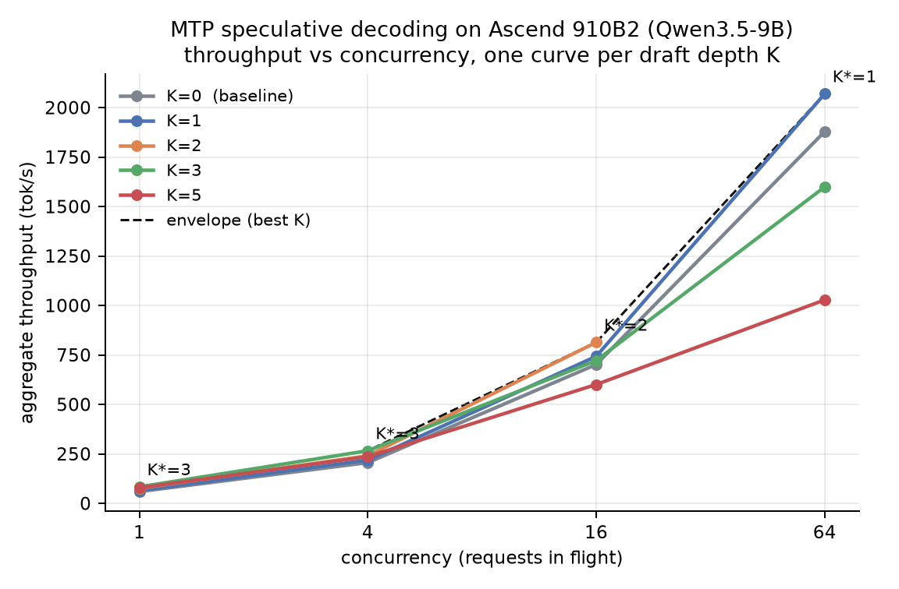
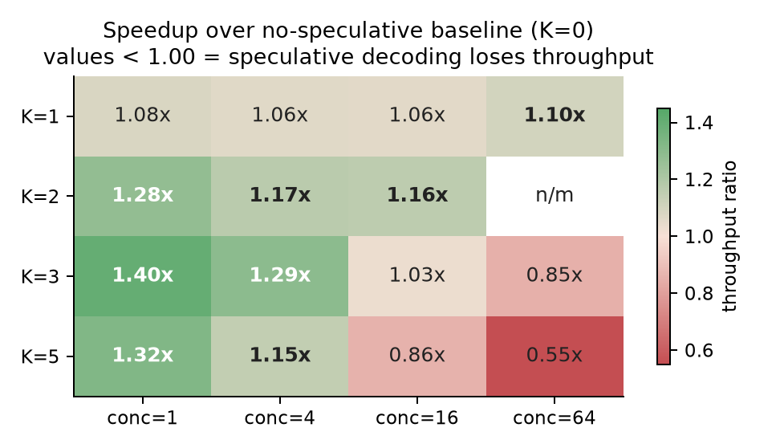
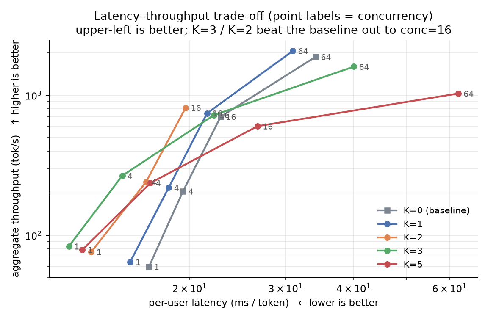
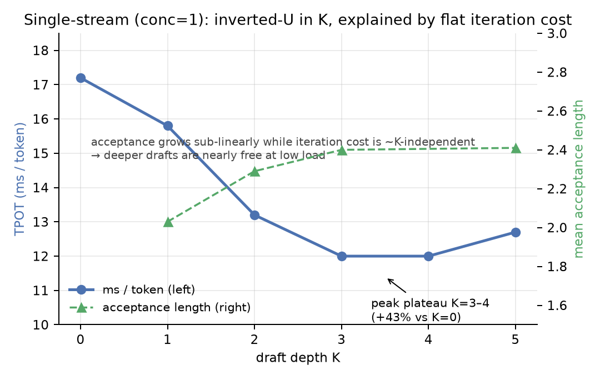

# MTP 投机解码在昇腾 910B 上的收益包络、性能归因与平台边界

**An Ablation and Attribution Study of Multi-Token-Prediction Speculative Decoding on Ascend 910B**

| | |
|---|---|
| 平台 | Ascend **910B2**（单卡，HBM 64 GB，TP=1） |
| 模型 | **Qwen3.5-9B**（内置 MTP draft 层），bf16 |
| 推理栈 | vLLM **0.26.0** + vllm-ascend **v0.26.0rc** @ `85625bd77` |
| 计算图 | `cudagraph_mode = FULL_AND_PIECEWISE`（ACL Graph） |
| 实验规模 | K×并发矩阵 5×4（20/24 格）+ 单流深度扫描 K=0…5 + 逐算子 trace 差分 |
| 测量口径 | 非流式墙钟定时 + 服务端接受率计数差分（**双口径互证**） |
| 日期 | 2026-10 |

---

## 摘要 / Abstract

**中文**：投机解码（MTP）在国产 NPU 上的收益曾被内部基准判定为"恒为负收益"。本文首先证明**该结论源于客户端测量伪影**：流式基准在投机解码下对实验臂单侧多计约 19 ms/迭代，同时 EOS 早停使分母逐轮漂移。以双口径方法重建测量后，结论反转为**单流 TPOT −43%**（12.0 vs 17.2 ms/token，K=3）。在此基础上，本文测得投机解码的**收益包络**：最优草稿深度随并发单调下降（K\* = 3/3/2/1，对应 +40%/+29%/+16%/+10%），并在 K=5@conc=16（0.86×）与 K=3@conc=64（0.85×）处观测到**收益符号翻转**；同期接受长度保持稳定（2.38–2.41），证明翻转源于验证算力约束而非接受质量下降。第三，本文将开销**归因到算子级**：相对无投机基线的宿主边际为 +4.25 ms/迭代（同步 2.9 / 内核派发 1.1 / 数据搬运 0.4），且新增 117 个小算子仅带来 0.64 ms 设备时长——表明该平台瓶颈位于**内核派发而非内存分配**。最后，本文把"为运行时草稿深度补图"（动态投机 + 按 K 的图捕获）推进至平台边界：实现全链路并逐层根因修复 6 类缺陷，使**启用上游动态投机通道的代价由 −58% 降至 0%（+135%）**；并以同形对照实验证明，剩余失效来自平台"多形状计算图交替回放"这一路径本身，与上游在配置可变 K 时禁用 FULL 图的设计决策互相印证。

**English**: Speculative decoding with multi-token prediction (MTP) on Ascend NPUs had been judged internally as a consistent net loss. We first show that this verdict is a **client-side measurement artifact**: a streaming benchmark charges the speculative arm ~19 ms/iteration that the baseline does not pay, and early EOS drifts the denominator. With a dual-caliber measurement (non-streaming wall-clock + server-side acceptance-counter differencing), the result reverses to **−43% TPOT** at single stream. We then map the **operating envelope**: the optimal draft depth falls monotonically with concurrency (K\* = 3/3/2/1 → +40/+29/+16/+10%), and the sign of the gain **flips** at K=5/conc=16 (0.86×) and K=3/conc=64 (0.85×) while acceptance length stays flat (2.38–2.41) — the flip is verify-compute pressure, not quality loss. Operator-level traces attribute a **+4.25 ms/iteration** host marginal (sync 2.9 / launch 1.1 / copy 0.4) and show that 117 additional kernels cost only 0.64 ms of device time, i.e. the platform is **dispatch-bound rather than alloc-bound**. Finally we take per-K graph capture to the platform boundary: implementing the full chain reduces the cost of enabling upstream dynamic speculation from **−58% to 0% (+135%)**, and a same-shape control experiment proves the residual failure lies in the platform's replay of alternating graph sets — consistent with upstream's decision to disable FULL graphs under variable K.

## 目录

1. [研究背景与动机](#1-研究背景与动机)
2. [实验设置](#2-实验设置)
3. [测量方法与口径](#3-测量方法与口径)
4. [实验结果：收益包络](#4-实验结果收益包络)
5. [性能归因](#5-性能归因)
6. [优化实践及其量化结论](#6-优化实践及其量化结论)
7. [平台边界：按 K 补图的失效判定](#7-平台边界按-k-补图的失效判定)
8. [复现指南](#8-复现指南)
9. [局限性与后续工作](#9-局限性与后续工作)
10. [附录与参考](#10-附录与参考)

---

## 1. 研究背景与动机

**为什么是 Qwen3.5 + MTP。** Qwen3.5 系列在主干之外自带一个 MTP（multi-token prediction）草稿层，因此**不需要额外训练独立 draft 模型**即可获得投机解码能力。对国产算力部署而言，这是投入产出比最高的延迟优化入口——但也意味着草稿头的形状、KV 复用与验证流程完全由推理框架决定，优化空间只存在于引擎内部。

**为什么需要重新测量。** vllm-ascend 作为硬件插件天然滞后于 vLLM 主干（本次栈对应主干 0.26，主干当时已至 0.32+），**主干上成立的最优配置在 NPU 上未必成立**。当时流传的"MTP 在昇腾恒负收益"结论来自一次流式基准，未经口径审查。

**NPU 环境的三个约束条件决定了本项目的技术路线：**

| # | NPU 特性 | 对投机解码的直接影响 | 由此采取的措施（见 §6/§7） |
|---|---|---|---|
| ① | **ACL 静态计算图**按形状与显存地址整体烘焙；且平台**拒绝在推理服务运行期间发起图捕获**（错误码 `107029`） | 每请求 `1+K` 的均匀解码块要求图档位能被 span 整除；一旦运行时 K ≠ 配置 K，形状与档位均不成立 | 启动期穷尽预捕 + draft 图按 `(bucket, K)` 双键 + 档位表按 `lcm(span)` 重排 + **进图张量恒地址（双缓冲池化）** |
| ② | **带宽/算力比显著高于 GPU**，decode 阶段为权重带宽受限 | 验证阶段多算 `(K+1)` 份 token 在低并发几乎不增加时间、在高并发需真实付费 ⇒ 收益随并发变号 | 以并发为一等维度做矩阵扫描，输出**分档调度表**而非单一最优 K |
| ③ | **宿主→设备派发昂贵**（aclnn ≈ 12.7 µs/次，CUDA ≈ 3 µs），且 profiling 工具链与 GPU 生态不同构 | 图外胶水算子的成本由**派发次数**决定；Nsight 类工具不可用 | 使用 vLLM 官方 profiler 通道（`--profiler-config` + `/start_profile`）做逐算子差分归因；把"池化 vs 进图"的取舍建立在派发计数上 |

---

## 2. 实验设置

| 项目 | 取值 |
|---|---|
| 硬件 | Ascend 910B2，单卡 HBM 64 GB，TP=1，无量化 |
| 软件 | vLLM 0.26.0；vllm-ascend v0.26.0rc @ `85625bd77`；CANN + torch_npu（实例镜像自带版本） |
| 模型 | Qwen3.5-9B（bf16），内置 1 层 MTP 草稿头 |
| 服务参数 | `--max-model-len 8192 --gpu-memory-utilization 0.85 --host 0.0.0.0 --port 8000` |
| 投机配置 | `{"method":"mtp","num_speculative_tokens":K}`，K ∈ {0,1,2,3,5}（单流深度扫描另含 K=4） |
| 请求负载 | `/v1/completions`，**非流式**，`max_tokens=128`，`temperature=0`（贪心），不屏蔽 EOS |
| 并发控制 | 客户端信号量，`concurrency ∈ {1,4,16,64}`（2 的幂，含 1 与饱和端） |
| 重复与统计 | 每格 3 轮取中位数；噪声带经重复实验标定为 ±0.7 ms/token |
| 隔离纪律 | 每换一个 K：彻底清进程与设备 → 确认 `npu-smi` 无残留进程 → 重启服务 → `/health` 轮询就绪 |
| 日志纪律 | **每臂独立日志文件**（早期曾因共享日志被覆盖而丢失一次故障现场） |

> 批尺寸取 2 的幂且必含上下限、输出长度 128 token 已足以刻画性能空间、warmup 剔除与中位数统计，均遵循公开基准规范（见 §10 参考）。

---

## 3. 测量方法与口径

### 3.1 问题：错误口径如何产生错误结论

初始结论"MTP 恒负收益（TPOT 17.5 vs 15.7 ms）"来自 vLLM 自带的流式压测客户端。逐项排查后确认存在三个**互相掩盖**的缺陷：

| 缺陷 | 机理 | 影响方向 |
|---|---|---|
| 流式分块成本 | 投机解码每个 SSE 分块通常仅携带 1–2 个 token，客户端分块解析/回调成本被计入逐 token 时延；K=0 每轮稳定输出 1 个 token，几乎不受影响 | **仅惩罚实验臂** ~19 ms/迭代 |
| EOS 早停 | 同一 prompt 实际输出 140 token（上限 256）；若以 `max_tokens` 为分母则每轮分母漂移 | 系统性偏差 + 轮间抖动 |
| 计数器窗口语义 | vLLM 的 SpecDecoding 指标按 **10 秒窗口清零**（非累计） | 跨窗口差分产生荒谬值（曾测得 acceptance = 25.6） |

### 3.2 采用的双口径定义

```
外部口径：非流式请求墙钟 elapsed（TTFT 单列，不计入 TPOT）
内部口径：同一时间窗内服务端 Drafted / Accepted 计数做差分

每轮迭代成本  t_iter = (elapsed − TTFT) / Δiters
每 token 成本  t_tok  = (elapsed − TTFT) / completion_tokens        ← 分母为实测输出长度
接受长度       acc    = completion_tokens / ΔDrafted
```

两条口径必须给出**一致**的结论才允许写入结果；不一致时引入第三口径仲裁（例如服务端日志窗口吞吐），**禁止通过调参拟合矛盾**。本报告全部数字满足该条件。

### 3.3 指标口径换算（本报告严格遵守）

| 数值 | 含义 | 换算关系 |
|---|---|---|
| 12.0 / 15.8 / 17.2 ms | **每 token**（t_tok） | `t_iter / acc` |
| 30.1 / 31.8 ms | **每轮迭代**（t_iter，主基准批次） | `t_tok × acc` |
| 26.1 / 25.1 ms | **每轮迭代**（诊断批次，代码版本较早，不可与上一行混用） | — |
| 15.7 ms | K=0 的每轮 = 每 token（每轮仅产出 1 token） | 带宽地板 |

---

## 4. 实验结果：收益包络

### 4.1 主表（聚合吞吐 tok/s；括号为对同并发 K=0 基线的倍数）

| K \ 并发 | 1 | 4 | 16 | 64 |
|---|---|---|---|---|
| 0（无投机基线） | 59.4 | 205.7 | 701.6 | 1878.8 |
| 1 | 64.3 (1.08×) | 218.5 (1.06×) | 743.0 (1.06×) | **2069.4 (1.10×)** |
| 2 | 75.8 (1.28×) | 240.4 (1.17×) | **813.6 (1.16×)** | 未测 |
| 3 | **83.3 (1.40×)** | **265.9 (1.29×)** | 721.6 (1.03×) | 1599.0 (0.85×) |
| 5 | 78.7 (1.33×) | 236.0 (1.15×) | 600.5 (0.86×) | 1028.0 (0.55×) |

单流每 token 延迟（K = 0…5）：`17.2 → 15.8 → 13.2 → 12.0 → 12.0 → 12.7` ms，**峰值 −43%，K ∈ {3,4} 为平台期**。
平均接受长度：K=1 → 2.03；K=2 → 2.26–2.32；K=3 → **2.38–2.41（并发 1→64 全程稳定）**。

### 4.2 三条可引用结论

1. **最优草稿深度随并发单调下降**：K\* = 3 / 3 / 2 / 1（并发 1 / 4 / 16 / 64）。
2. **收益符号会发生翻转**：K=5 在并发 16 跌至 0.86×，K=3 在并发 64 跌至 0.85×，K=5 在并发 64 为 0.55×。
3. **翻转与接受质量无关**：K=3 接受长度全程不变（2.38–2.41）⇒ 翻转完全由**验证阶段的算力竞争**解释。故固定单一 K 的策略在本硬件上必然在某些工况倒赔，需要按并发分档配置。

### 4.3 图

**图 1** — 吞吐-并发饱和曲线与逐列最优包络（标注 K\*）。



**图 2** — 相对基线的加速比热图；红色区域即"不应开启投机解码"的工作区。



**图 3** — 延迟-吞吐权衡（数据点标注并发数；左上为优）。



**图 4** — 单流场景下 K 的倒 U 曲线，叠加接受长度；机制为"接受长度次线性增长 + 迭代成本与 K 近似无关"。



---

## 5. 性能归因

### 5.1 成本模型

```
t_iter(B, K) ≈ a(K) + B · c(K)
   a(K)    ：每轮固定成本（内核派发、图外胶水、同步）——被 E[tok|K] 摊薄
   B·c(K)  ：随请求数线性增长的验证计算成本
```

单流实测 `t_iter(K=1) = 31.8 ms`、`t_iter(K=3) = 30.1 ms` ⇒ **迭代成本与 K 近似无关**（权重带宽受限的矩阵-向量乘，多算 K 份 token 几乎不增加时间）。两式对 B 的依赖方向相反，**必然**产生"最优 K 随并发下降且仅翻转一次"的结构，与 §4 实测一致。

### 5.2 逐算子边际分解（K=1 相对 K=0，单位 ms/迭代）

| 项目 | 边际 | 定性判断 |
|---|---|---|
| 主机侧硬同步 `Event.synchronize` | **+2.9**（3 次/迭代） | 最大单项 |
| 内核派发与 HostArgs 组装 | +1.1（+117 次） | 结构性（draft/verify 新增 GEMM 的派发） |
| InplaceCopy(+workspace) / Index / MemcpyAsync | +0.41 / +0.29 / +0.18 | 图外元数据胶水 |
| 动态形状内核 +117 个 | 设备时长仅 +0.64 | **小算子成本位于派发次数，而非计算** |

### 5.3 设备侧

静态形状内核占 85% 设备时长，单核 `MatMulV2` 943 ms 为带宽地板，图内等待 ≈ 0 —— 即**已捕获的图是健康的**。但 K=1 时设备利用率仅 **58%**（K=0 为 92%）⇒ 每轮约 13 ms 空窗，构成 §5.2 宿主边际的对应面，也是后续图化工作的理论空间上界。

---

## 6. 优化实践及其量化结论

三条路线均由 §5 的归因驱动，并全部以双口径实测给出结论（含负结果）。

### 6.1 使能动态投机配置：代价由 −58% 降至 0%（+135%）

上游已提供动态投机通道（`num_speculative_tokens_per_batch_size`），但在 vllm-ascend 上**一旦启用即把 `cudagraph_mode` 由 FULL_AND_PIECEWISE 降级为 PIECEWISE**；实测该降级使单流每 token 时延升至 **28.2 ms**（静态 K=3 为 12.0 ms，即 **−58%**）。

本工作在 vllm-ascend 侧补齐该路径，使**配置档（K 与配置相同的步）恢复至静态最优**：实测 82.7–84.1 tok/s（静态 K=3 为 83.3）、per-token 12.0 ms ⇒ 启用该通道的代价由 −58% 降为 **0**，即该路径 **+135%**。实现要点：

- 从 `SchedulerOutput.scheduled_spec_decode_tokens` 取**本步真实 span**（注意 `num_spec_tokens_to_schedule` 描述的是**下一步**要草稿的数量，二者语义相差一步，不可混用）；
- 草稿模型图按 **`(bucket, K)` 双键**登记，使同一 token 档位可容纳多个草稿深度（例如 4 请求×K=1 与 2 请求×K=3 同为 8 token）；
- **启动期穷尽预捕**调度表中出现的所有 K（平台拒绝运行期捕获，因此不存在"漏了再补捕"的退路）；
- 图档位表按 **`lcm(所有 span)`** 重排（核心框架只按**配置** span 调整档位 ⇒ 运行时 span 无合法档位）；
- **覆盖守卫**：若某步档位落在预捕集合之外，草稿侧保持配置 K、目标侧放弃 FULL，而不是要求一张不存在的图。

### 6.2 图外元数据池化：−0.5 ms/token（处于噪声带内），价值为地址稳定性

实现：pinned buffer 双块交替（异步 H2D 在途期间不得被覆写，此项同时消除一处**正确性隐患**）、CPU 端 arange 预建、block-table 复用缓冲区。

结果：每轮投机 26.1 → 25.1 ms（−1.0 ms/轮），折算 per-token ≈ **−0.5 ms**，落在 ±0.7 ms 噪声带内 ⇒ **性能中性**。根因判据：该平台按派发次数定价（aclnn ≈ 12.7 µs/次 vs CUDA ≈ 3 µs），而 caching allocator 使分配近乎免费 ⇒ 瓶颈为 **dispatch-bound 而非 alloc-bound**，池化所节省的并非稀缺资源。其净价值转为**进图张量的地址稳定性**——这正是 §6.1 预捕能够成立的前提，与上游为 GLM 系列实施同类池化的动机一致（使能型优化，而非加速型）。

### 6.3 主机侧同步消除：定位精确，但实测不在关键路径

自研 per-site 计时模块（环境变量门控、逐站点累计、每 256 次打印一次）测得 `num_accepted_tokens_event.synchronize()` 每次阻塞 **6.1 ms**，并修正了此前由 API 统计推断的 2.9 ms（该口径漏计了 torch_npu 事件轮询的内部耗时）。

随后提供 A/B 开关（默认保留原行为）跳过该同步：输出正确、接受长度 1.80 不变、**性能无实质差异**（K=1 为 15.7–16.1 vs 基线 15.8；K=3 为 11.6–11.8 vs 12.0 ms/token）。结论：该等待确属无效，但被设备忙等遮蔽，**不位于关键路径**。

> 本条的产出为**否决性结论 + 一个可上游的安全开关**：由此避免了以"消同步"为目标的一轮重写，并把剩余约 3 ms/迭代 的同步归至 vLLM 核心侧（超出本 fork 边界）。

---

## 7. 平台边界：按 K 补图的失效判定

§6.1 的机制全部可用，但**运行时 K ≠ 配置 K 的那一步仍然失效**。逐层排查记录如下（每层均含错误码或复现条件）：

| 层 | 现象 | 根因 | 处置 |
|---|---|---|---|
| 1 | 启用配置即被降级 PIECEWISE | 核心框架的 FULL 图含 `view(-1, K, vocab)`，形状绑定配置 K | 转入自研路径 |
| 2 | 设备报 `561002  queryT ≠ actualSequenceLengthQ` | FIA 的 padding 仍按配置 span 计算 | padding 改用运行时 span |
| 3 | 混合批（含 prefill）草稿模型崩溃 | 草稿继承目标的 uniform 标志 → 掉出图 → AOT 工件按配置 K 形状执行 | 仅在 decode-only 步强制 uniform |
| 4 | 运行期捕获被拒 `107029` | ACL 不支持服务运行期间开始 task-group 捕获 | 只能启动期穷尽预捕 |
| 5 | 服务启动即 `AttributeError` | 运行时 span 属性仅在动态路径赋值，而 `_dummy_run` 必经该读取点 | `__init__` 初始化 + 防御式读取 |
| 6 | 捕获期 `assert num_tokens_padded % span == 0` | 档位表只按**配置** span 调整 ⇒ span=3 无合法档位 | 档位表按 `lcm(span)` 重排 |
| **7** | **切换步仍失效** | **见下方对照实验** | **判定为平台限制，停止推进** |

**第 7 层的判定实验（同形对照）**

使用同一形状的图（16 请求 × K=2 ⇒ 48 token，零 padding），唯一差别是"配置 K 是否等于本步 K"：

| 场景 | 本步 K = 配置 K？ | 结果 |
|---|---|---|
| 服务器全程配置 K=2，conc=16 | 是 | **正常，813.6 tok/s** |
| 配置 K=3、调度表将 conc≥5 降为 2，conc=16 | 否 | **设备异常（HTTP 500，33 处 aivec 错误）** |
| 同上，小批（reqs = 2–3） | 否 | **静默挂死，无任何错误码** |
| 配置 K=3、降为 K=1，conc=16（32 token / 16 req，档位合法） | 否 | **HTTP 500 + 设备错误** |
| 任意并发、K 保持配置值 | 是 | 全程正常 |

批大小、span 奇偶、档位方案、图是否存在与是否命中（trace 证明切换确实发生、图被选中且未被禁用）被逐项排除后，**唯一存活的自变量是该步是否更换了 K** —— 即该平台在"两套不同形状的图逐帧交替回放"这条路径上不工作。

三条旁证与上述结论一致：(i) 上游在检测到可变 K 配置时直接禁用 FULL；(ii) vllm-ascend 自身的 `fused MTP full graph`（PR #10174）选择把 target 与 draft **合并为一张图**，即消灭交替而非支持交替；(iii) 平台拒绝服务运行期捕获，说明图生命周期管理本身在运行期受限。

因此本项目在第 7 层的交付为：**完整可运行的机制 + 精确复现条件 + 上述对照表**，作为路线图与上游 issue 素材。继续推进需要平台级隔离实验（多进程各持一套图，或两套图仅在互不重叠的形状上回放），已超出单卡实验的合理成本范围。

---

## 8. 复现指南

```bash
# (1) 启动服务（以 K=3 为例）
export LD_LIBRARY_PATH=/usr/local/Ascend/nnal/atb/<CANN-ver>/atb/cxx_abi_1/lib:$LD_LIBRARY_PATH
vllm serve /path/Qwen3.5-9B --host 0.0.0.0 --port 8000 \
  --max-model-len 8192 --gpu-memory-utilization 0.85 \
  --speculative-config '{"method":"mtp","num_speculative_tokens":3}' > k3.log 2>&1 &

# (2) 轮询就绪（不要用固定 sleep：图捕获耗时会漂移）
for i in $(seq 1 40); do sleep 10
  curl -s --max-time 2 http://127.0.0.1:8000/health >/dev/null 2>&1 && { echo READY; break; }
done

# (3) 双口径并发基准（非流式 + 服务端计数差分）
python3 tools/benchxc.py --model /path/Qwen3.5-9B --concurrency 16 \
  --rounds 3 --timeout 120 --server-log k3.log
# 输出：[conc=16 rounds=3] wall=… reqs=… tokens=… agg=…tok/s per_tok=…ms
#        req_p50=… | iters=… acc_len=… per_iter=…

# (4) 更换 K 之前必须彻底清卡，否则下一次启动会在图捕获阶段失败
pkill -9 -f 'spawn_main|EngineCore|vllm' ; sleep 20 ; npu-smi info | tail -n 12   # 需显示 No running processes

# (5) 重新生成本报告图表（数据内联，另存 data/matrix.csv）
python3 tools/make_figs.py <输出目录>
```

**复现注意事项（均为实测踩坑）**：`pkill -f vllm` 无法匹配 spawn 出的 `EngineCore` 进程；固定 `sleep` 在图捕获较慢时会撞上 `Connection refused`；`--server-log` 必须指向**本轮**日志文件，否则接受率指标会被静默丢弃。

---

## 9. 局限性与后续工作

**覆盖范围**：单卡 TP=1、bf16、非流式、贪心解码、短入短出（ISL≈10 / OSL=128）、并发 1–64、K 0–5。

**未覆盖 / 不可外推**：

1. **负载形状单一**。未测长输入短输出与长输出；`c(K)` 的相对权重会随输入与输出长度改变，包络数字不可直接外推。
2. **未涉及多卡与量化**。TP>1 时通信进入 `c(K)`；量化改变带宽/算力比，倒 U 顶点位置随之移动。
3. **贪心解码给出接受率上界**。采样解码下接受率更低，最优 K 预期整体下移。
4. **矩阵缺 1 格**（K=2 @ 并发 64）；第 4 列包络由 K=1 支撑，不影响结论方向。
5. **§6/§7 的最后两个提交（档位表重排与取证日志）未在硬件重跑**。其"不改变判定"的结论由档位集合枚举论证：span=2 时新旧档位完全相同；K=2@并发 16 所需的 48 token 在两种方案下都是精确档位、零 padding，而该形状已两次实测失效。引用本报告时应保留此限定。
6. **差分精度受日志窗口限制**（服务端指标为 10 秒窗口），因此本报告**不以单轮 `Δiters` 差分作独立结论**，一律以 per-token 与聚合吞吐为准，并由双口径互证。

**后续方向（按预期收益排序）**：① 上游 `fused MTP full graph`（将 target 与 draft 合并为单图，绕开多图交替）；② 若平台支持运行期捕获或提供 per-K 图原语，§7 的机制可立即兑现 +16%@16 / +10%@64 的档位收益；③ 采样解码下的接受率-深度重标定。

---

## 10. 附录与参考

**数据与代码**

| 内容 | 位置 |
|---|---|
| 矩阵原始数据 | `data/matrix.csv` |
| 双口径并发基准 | `tools/benchxc.py` |
| 图表生成脚本 | `tools/make_figs.py` |
| 测量协议与统计纪律（完整版） | `docs/MEASUREMENT_PROTOCOL.md` |
| 引擎侧改动（13 提交：双键图、档位重排、覆盖守卫、同步计时、池化、取证日志） | https://github.com/lynnhommie/vllm-ascend/tree/f2p-mtp-first-pass |

**关键代码位置（便于快速定位）**

`vllm/v1/cudagraph_dispatcher.py`（档位→批描述符、`initialize_cudagraph_keys`）· `vllm/config/compilation.py: adjust_cudagraph_sizes_for_spec_decode`（档位与配置 span 的整除约束）· `vllm/v1/spec_decode/metrics.py`（逐位置接受率即链式接受率）· `vllm_ascend/spec_decode/llm_base_proposer.py`（草稿 K 重绑与图派发）· `vllm_ascend/attention/attention_v1.py`（FIA 图参数表按 `(bucket, span)` 键控）· `vllm_ascend/patch/worker/patch_cudagraph.py`（运行时 span 的档位补齐）

**方法与规范参考**

- vLLM 官方基准扫参指南：serial 与饱和两个锚点、吞吐-并发饱和曲线、延迟-吞吐 Pareto、优先使用 `max_concurrency`。
- IBM FMwork（arXiv 2508.10251）：批尺寸按 2 的幂且必含上下限、128 输出 token 足以刻画性能空间（对 1024 保真度 96.6%）、warmup 剔除、取中位数、迭代变异 <5% 作为收敛判据。
- AWS《How to Build an LLM Inference Benchmark That Doesn't Lie》、NVIDIA《LLM Inference Benchmarking Fundamentals》：口径定义、分母、尾部延迟与 goodput。
- vllm-ascend 相关实践：GLM-Next MTP draft 图与池化（PR #17178）、EAGLE ACL-Graph RFC #5459、NPU 上的 MTP 图捕获（PR #16214、Issue #15665）、fused MTP full graph（PR #10174）。

---

*本报告数据若用于对外引用，请连同 §9 的适用边界一并转述。*
